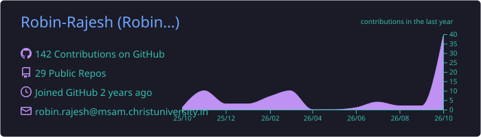
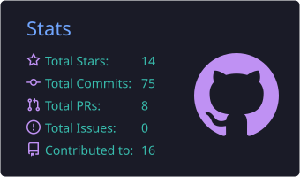
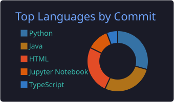
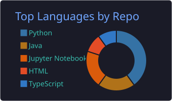
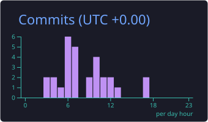

# Hi, I'm Robin Rajesh 👋

### **Full-Stack AI Engineer** · LLMs · Agents · MCP · Machine Learning

*Building intelligent systems end to end, from model experiments to production-ready AI applications.*

---

## 🧠 About Me

- 🤖 I build **AI agents, LLM-powered apps and MCP servers**
- 🛡️ Building **AI contract risk analysis** with LLMs, RAG and OCR ([pact-protect](https://github.com/Robin-Rajesh/pact-protect))
- 📊 Built an **agentic data analyst** that turns plain-English questions into SQL, charts and reports ([SYS_project](https://github.com/Robin-Rajesh/SYS_project))
- 🎙️ Built **10 real-time voice agents in 10 days** for the [murf.ai challenge](https://github.com/Robin-Rajesh/ten-days-of-voice-agents-2025)
- 📜 Completed the AWS **Machine Learning Engineer - Associate** exam-prep track ([certificates](https://github.com/Robin-Rajesh/ML-Engineer-Certificates))

---

## 🛠️ Tech Stack

**Languages**

**AI / ML**

**Apps, Data & Tools**

---

## 🚀 Projects Portfolio

### 🎙️ Spotlight: 10 Days of AI Voice Agents

**10 real-time voice agents in 10 days** for the [murf.ai](https://murf.ai) AI Voice Agents Challenge, built with LiveKit, Murf Falcon TTS, Deepgram and Gemini.

| Day | Agent | Highlights |
|:---:|---|---|
| 1 | [Starter Voice Assistant](https://github.com/Robin-Rajesh/ten-days-of-voice-agents-2025/tree/main/day-01-starter-agent) | Full STT → LLM → TTS voice pipeline |
| 2 | [Coffee Shop Barista](https://github.com/Robin-Rajesh/ten-days-of-voice-agents-2025/tree/main/day-02-coffee-barista) | Voice ordering with a live drink visualizer |
| 3 | [Wellness Companion](https://github.com/Robin-Rajesh/ten-days-of-voice-agents-2025/tree/main/day-03-wellness-companion) | Daily check-ins that remember previous days |
| 4 | [Teach-the-Tutor](https://github.com/Robin-Rajesh/ten-days-of-voice-agents-2025/tree/main/day-04-teach-the-tutor) | Learn, quiz and teach-back modes, each with its own voice |
| 5 | [SDR Sales Agent](https://github.com/Robin-Rajesh/ten-days-of-voice-agents-2025/tree/main/day-05-sdr-agent) | Razorpay FAQ answers and lead capture |
| 6 | [Fraud Alert Agent](https://github.com/Robin-Rajesh/ten-days-of-voice-agents-2025/tree/main/day-06-fraud-alert) | Caller verification and transaction review |
| 7 | [Grocery Ordering](https://github.com/Robin-Rajesh/ten-days-of-voice-agents-2025/tree/main/day-07-grocery-ordering) | Cart, "ingredients for a dish" and order tracking |
| 8 | [Stranger Things Game Master](https://github.com/Robin-Rajesh/ten-days-of-voice-agents-2025/tree/main/day-08-game-master) | D&D-style voice adventure with a themed UI |
| 9 | [Voice Shopping Agent](https://github.com/Robin-Rajesh/ten-days-of-voice-agents-2025/tree/main/day-09-voice-shopping) | Commerce flow inspired by the Agentic Commerce Protocol |
| 10 | [Improv Battle](https://github.com/Robin-Rajesh/ten-days-of-voice-agents-2025/tree/main/day-10-improv-battle) | AI game-show host with 15 improv scenarios |

### ⭐ Featured

| Project | Description | Stack |
|---|---|---|
| [**pact-protect**](https://github.com/Robin-Rajesh/pact-protect) | AI contract derisking: clause-level risk ratings, policy checks, RAG, OCR for scanned PDFs, and safer-wording suggestions | React · TypeScript · FastAPI · Qdrant |
| [**SYS_project**](https://github.com/Robin-Rajesh/SYS_project) | Enterprise AI data analytics portal: ask questions in plain English and get SQL results, charts and executive reports | Gemini · LangChain · Supabase · React |
| [**Adaptive-Interview-bot**](https://github.com/Robin-Rajesh/Adaptive-Interview-bot) | AI mock interviews with adaptive questions and NLP answer scoring (ROUGE, BLEU, semantic similarity) | Groq Llama 3 · Streamlit |
| [**expense-tracker**](https://github.com/Robin-Rajesh/expense-tracker) | MCP server that lets an AI assistant log expenses, email reports, back up to Drive and set Calendar reminders | Python · FastMCP · Google APIs |

### 🤖 Agents, LLMs & MCP

| Project | Description | Language |
|---|---|---|
| [**Logs_MCP**](https://github.com/Robin-Rajesh/Logs_MCP) | MCP servers for expense tracking and a system health dashboard | Python |
| [**Lab4_LLM**](https://github.com/Robin-Rajesh/Lab4_LLM) | Voice-enabled multilingual Q&A over PDFs in English, Malayalam and French (Whisper, FLAN-T5, gTTS) | Python |
| [**LLM_lab4**](https://github.com/Robin-Rajesh/LLM_lab4) | Early version of the multilingual Q&A system | Python |
| [**code-specialized-llm**](https://github.com/Robin-Rajesh/code-specialized-llm) | Compares GPT-2 and CodeGen on code generation using BLEU and CodeBLEU-style scoring | Python |
| [**LLM3**](https://github.com/Robin-Rajesh/LLM3) | Foundation vs domain-specific model comparison for healthcare and legal text | Python |
| [**cia**](https://github.com/Robin-Rajesh/cia) | Short story generation with FLAN-T5 | Jupyter Notebook |
| [**ai-agent-challenge**](https://github.com/Robin-Rajesh/ai-agent-challenge) | Coding agent that writes custom parsers for bank statement PDFs *(fork)* | Python |
| [**LLM**](https://github.com/Robin-Rajesh/LLM) | Large language models coursework *(empty)* | - |

### 🎙️ Speech, NLP & Computer Vision

| Project | Description | Language |
|---|---|---|
| [**DL_project**](https://github.com/Robin-Rajesh/DL_project) | CameraBot: live YOLOv5 object detection plus a voice-controlled Ollama chatbot | Python |
| [**NLP_Exam**](https://github.com/Robin-Rajesh/NLP_Exam) | Movie review spoiler detection: TF-IDF + XGBoost vs BiLSTM + GloVe | Jupyter Notebook |
| [**SPR-CIA-3-LAB**](https://github.com/Robin-Rajesh/SPR-CIA-3-LAB) | DTW speech alignment and online vs offline speech-to-text (Whisper) | Jupyter Notebook |
| [**SPEECH-PATTERN-RECOGNITION**](https://github.com/Robin-Rajesh/SPEECH-PATTERN-RECOGNITION) | LPC analysis, signal reconstruction and formant estimation | Jupyter Notebook |
| [**SPR-LAB2**](https://github.com/Robin-Rajesh/SPR-LAB2) | Speech pattern recognition lab 2 *(empty)* | - |
| [**ML-Engineer-Certificates**](https://github.com/Robin-Rajesh/ML-Engineer-Certificates) | AWS Machine Learning Engineer - Associate (MLA-C01) exam-prep certificates | - |

### 📊 Data Analysis

| Project | Description | Language |
|---|---|---|
| [**Exploratory-Data-Analysis-of-Online-Retail-Dataset-using-R**](https://github.com/Robin-Rajesh/Exploratory-Data-Analysis-of-Online-Retail-Dataset-using-R) | Online retail analytics in R with a Flask web dashboard | R · Python · HTML |

### 💻 Apps & UI

| Project | Description | Language |
|---|---|---|
| [**IT-Helpdesk-UI-Adaptive-Cards-**](https://github.com/Robin-Rajesh/IT-Helpdesk-UI-Adaptive-Cards-) | Adaptive Card templates for Microsoft Copilot Studio chatbots | JSON |
| [**figma**](https://github.com/Robin-Rajesh/figma) | QuickBite food-ordering mobile UI prototype, from Figma to React | TypeScript |
| [**FinalCletusRobin**](https://github.com/Robin-Rajesh/FinalCletusRobin) | Deployed CollabCanvas · [live demo](https://fyp-cletus-robin.vercel.app/) *(fork)* | - |
| [**template-fps**](https://github.com/Robin-Rajesh/template-fps) | Open source FPS shooter template built on Elympics · [live demo](https://template-fps.elympics.cc) *(fork)* | - |
| [**Risk_Management**](https://github.com/Robin-Rajesh/Risk_Management) | Risk management project *(just started)* | - |

### 📚 Java & Coursework

| Project | Description | Language |
|---|---|---|
| [**Java_Labs**](https://github.com/Robin-Rajesh/Java_Labs) | OOP labs: payroll system, collections with comparators, and algorithm assignments | Java |
| [**JavaCIA**](https://github.com/Robin-Rajesh/JavaCIA) | Library management system and matrix rotation | Java |
| [**Assignment-5**](https://github.com/Robin-Rajesh/Assignment-5) | Interfaces and abstract classes: bank accounts and rainwater trapping | Java |
| [**Assignment-4**](https://github.com/Robin-Rajesh/Assignment-4) | House Robber dynamic programming variations | Java |
| [**Assignment-3**](https://github.com/Robin-Rajesh/Assignment-3) | Assignment 3 *(empty)* | - |
| [**firstgitsession**](https://github.com/Robin-Rajesh/firstgitsession) | My first Git session | - |
| [**Robin-Rajesh**](https://github.com/Robin-Rajesh/Robin-Rajesh) | Config files for my GitHub profile | Markdown |

---

## 📈 GitHub Stats

---

### 🤝 Let's Connect

Open to collaborations on **AI agents, LLM applications and intelligent automation**.

⭐ *Feel free to explore my repositories and star the ones you find useful!*

